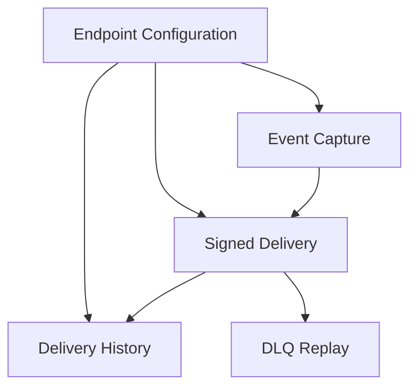

# Order Status Webhook Notifications

## 1. Executive Summary

The Order Status Webhook Notifications feature enables business customers to receive outbound HTTP notifications when an order changes status, instead of repeatedly polling the Order Management System (OMS). It serves the three B2B customers that requested real-time updates—Atlas Comercial, MaxDistribuição, and Nova Cargo—and their integration teams, as well as OMS administrators who manage failed deliveries.

The feature adds customer-scoped webhook configuration to the existing Node.js/TypeScript OMS, which uses Express and MySQL through Prisma. An order event is captured transactionally in a MySQL outbox and delivered asynchronously by a separate worker. Customers select the order statuses they want, verify request authenticity with HMAC-SHA256, inspect recent delivery history, and rely on scheduled retries and an administrator-managed dead-letter queue (DLQ) when their endpoint is unavailable.

## 2. Problem and Opportunity

### The Problem

**Polling-based customer integrations**
- Three B2B customers have formally requested notifications when their orders change status.
- They currently poll `GET /orders` to discover changes, making their integrations slower and more expensive.
- Customers consider a delay under 10 seconds to be real time; without event notifications they must keep checking for updates.
- Atlas Comercial has raised the possibility of migrating to a competitor if the capability is not delivered by the end of the quarter.

**External delivery must not block order operations**
- A status transition already updates the order, status history, and inventory in a database transaction.
- A slow or unavailable customer endpoint must not block status changes or cause a committed order change to be rolled back.
- The event must not be lost when the OMS transaction commits, nor remain if that transaction rolls back.

**Delivery must be secure and recoverable**
- Customers need to verify that notifications came from the OMS and that their payloads were not altered.
- Customer endpoints can be unavailable or slow, and the delivery contract permits duplicate notifications.
- Failed events need an operational recovery path, while customer secrets need endpoint-level isolation and rotation.

### The Opportunity

The feature replaces repeated polling with an asynchronous outbound notification path. A MySQL outbox written in the order transaction preserves consistency without adding a separate queueing infrastructure. A worker polls every two seconds, while the agreed first-attempt target is under 10 seconds for at least 95% of eligible events.

Per-endpoint status filters avoid creating deliveries that a customer did not request. HMAC-SHA256, HTTPS-only destinations, unique endpoint secrets, and secret rotation give customers a way to verify requests. A bounded retry schedule, separate DLQ, delivery history, and administrator replay make failures observable and recoverable without coupling customer availability to order processing.

### Decisions and Trade-offs

- **Transactional outbox instead of synchronous HTTP calls:** keeps customer latency and downtime outside the order transaction. It adds database polling and outbox lifecycle work.
- **MySQL outbox instead of Redis Streams:** reuses the existing database and avoids introducing infrastructure for a small team. The worker must poll and manage table growth.
- **Single worker polling every two seconds:** meets the stated latency need with a simple deployment model. Ordering is limited to per-order processing while a single worker runs; global ordering and parallel scaling are not promised.
- **At-least-once instead of exactly-once:** avoids cross-system coordination. Customers must deduplicate repeated deliveries using the stable `X-Event-Id`.
- **Retries followed by a separate DLQ:** bounds repeated attempts and preserves failures for investigation and manual replay; it does not guarantee delivery when a customer endpoint remains unavailable.
- **Existing project patterns:** webhook errors use the `WEBHOOK_*` code prefix and existing error handling; the feature reuses the modular structure, Pino logger, Zod validation, and authentication/role middleware.

### Risks and Mitigations

| Risk | Probability | Impact | Mitigation |
|---|---|---|---|
| A customer endpoint is unavailable or slow, delaying notification and eventually moving an event to the DLQ. | Medium | High | Apply the 10-second timeout, five scheduled retries, persist exhausted events in the DLQ, and allow an administrator to replay them. |
| At-least-once delivery causes a customer to receive an event more than once. | Medium | Medium | Assign one UUID per event in `X-Event-Id`; document that consumers should deduplicate using that ID. A DLQ replay retains the original ID. |
| A webhook secret is compromised. | Medium | High | Use a unique secret per endpoint, require HTTPS, support a 24-hour rotation overlap, and reserve two business days for security review before deployment. The at-rest protection mechanism remains an open technical decision. |
| Any authenticated user can manage webhook records for any customer ID in this version. | Medium | High | Require authentication on all configuration and history routes, document this residual access-scope risk, and complete the planned security review before deployment. Per-customer authorization is not part of this version. |

## 3. Target Audience

### Primary Users

**B2B Integration Engineer**
- Integrates a customer's order-management or fulfillment software with the OMS.
- Needs to configure an HTTPS endpoint and select which order statuses trigger notifications.
- Needs to verify signed requests, deduplicate deliveries, rotate secrets, and inspect recent delivery results.

**OMS Operations Administrator**
- Supports customer integrations and investigates notifications that could not be delivered.
- Needs to inspect failed-delivery records and replay a dead-lettered event.
- Needs the replay action attributed to the administrator who performed it.

### Behavioral Profile

- Both user groups interact with the OMS through authenticated APIs; the feature does not introduce a customer-facing visual dashboard.
- B2B integration users consume notifications in their own systems and are responsible for deduplicating repeated event IDs.
- Administrators use the existing `ADMIN` role for DLQ replay; other authenticated users can manage webhook configuration in this version.

## 4. Objectives

### Product Objectives

- **Notify** customers promptly when a subscribed order event occurs, without requiring repeated order polling.
- **Preserve** consistency between committed order changes and the corresponding eligible webhook events.
- **Recover** from customer endpoint failures through bounded retries and an auditable manual replay path.
- **Deliver** the agreed initial scope within the three-sprint planning estimate, including the security review.

### Success Metrics

| Objective | Metric | Measurement condition |
|---|---|---|
| Notify customers promptly | At least 95% of eligible events receive a successful 2xx response on the first attempt within 10 seconds of the source order event. | Measure daily from the source event timestamp to the first successful response; count the initial attempt only. |
| Preserve transactional consistency | 100% of eligible events for committed order operations are persisted in the same transaction; no corresponding outbox entry remains for a rolled-back operation. | Verify order creation and status-transition commit/rollback cases with transaction-level integration tests. |
| Recover failed deliveries | Every delivery that still fails after five retries is represented in the DLQ; the retry schedule is exactly 1 minute, 5 minutes, 30 minutes, 2 hours, and 12 hours after the preceding failed attempt. | Exercise timeout, connection failure, and non-2xx destination responses through the final retry and DLQ transition. |
| Deliver the planned scope | Complete within the three-sprint estimate, reserving at least two business days for security review before deployment. | Compare the release plan and completed review against the agreed estimate; no calendar date is specified in the meeting. |

## 5. User Stories

### F01. Webhook Endpoint Configuration
- As a B2B integration user, I want to create a webhook endpoint with an HTTPS URL and selected order statuses so that I receive only the events relevant to my integration.
- As a B2B integration user, I want to list, update, and remove webhook configurations for a customer ID in the route so that I can maintain my integration through the API.
- As a B2B integration user, I want the API to generate and return a unique endpoint secret at creation and rotation so that I can verify signed notifications.
- As a B2B integration user, I want the prior secret to remain valid for 24 hours after rotation so that I have time to update my verification configuration.

### F02. Transactional Order Event Capture
- As the system, I want to write an eligible status-change event to the outbox in the same transaction as the order change so that committed changes cannot lose their notifications.
- As the system, I want to record a `order.created` event for endpoints subscribed to `PENDING` so that customers can learn when a matching order is first created.
- As the system, I want to store the event payload as a snapshot when it is enqueued so that later order changes do not alter the earlier event.

### F03. Asynchronous Signed Delivery and Retry
- As the system, I want a separate worker to poll pending outbox events and send them to configured HTTPS endpoints so that external calls do not block the API or order transaction.
- As a B2B integration user, I want to verify the event ID, endpoint ID, timestamp, and HMAC signature in each request so that I can authenticate and deduplicate notifications.
- As the system, I want to retry failed requests on the agreed schedule and move exhausted events to a DLQ so that temporary endpoint outages do not immediately lose notifications.

### F04. Delivery History
- As a B2B integration user, I want to view the latest 100 deliveries for a webhook, including outcome, payload, response, and response time, so that I can diagnose integration problems.

### F05. Dead-Letter Replay
- As an OMS administrator, I want to replay a dead-lettered event so that I can retry delivery after the customer endpoint has recovered.
- As an OMS administrator, I want the replay action to be restricted to the `ADMIN` role and record who performed it so that recovery actions are auditable.
- As the system, I want a replay to retain the original event ID so that customer-side deduplication remains consistent.

## 6. Functionalities

### F01. Webhook Endpoint Configuration

**Provides:**
- Customer ID, endpoint ID, active state, and subscribed status/event filters (used by F02).
- Endpoint ID, HTTPS URL, active state, and secret-rotation information (used by F03).
- Customer ID and endpoint ID for selecting a webhook's delivery history (used by F04).

**Capabilities:**
- Provide authenticated API operations to create, list, update, and delete webhook configurations. The `customer_id` is supplied in the route, not derived from the JWT.
- Any authenticated user may manage configuration for any customer ID in this version; the current OMS roles are `ADMIN` and `OPERATOR`. No user-to-customer association or per-customer authorization is introduced.
- A configuration contains a destination URL, active state, and a list of order statuses/events to receive. Available order statuses are `PENDING`, `PAID`, `PROCESSING`, `SHIPPED`, `DELIVERED`, and `CANCELLED`.
- Accept HTTPS URLs only. Reject HTTP destinations with `WEBHOOK_INVALID_URL`.
- Generate a unique secret for each endpoint. Return the secret once on creation; do not reveal it again through list or read operations.
- Allow the authenticated user to request rotation. Return the new secret once in the rotation response and retain the prior secret for 24 hours. Which secret signs outbound requests during this overlap remains an open technical decision and is not specified here.
- Deleting a configuration prevents new events from being enqueued for it. Already-enqueued deliveries continue to be processed.
- No maximum number of endpoints per customer or status-filter entries was decided.

**Experience:**
- The caller authenticates using the existing OMS authentication.
- The caller supplies the customer ID in the route and submits an HTTPS URL and one or more subscribed statuses/events to create a configuration.
- On successful creation, the API returns the endpoint details and the generated secret once. Subsequent list or update responses do not reveal that secret.
- The caller can change the URL, active state, or subscribed statuses. New order events use the current active configuration and filters; already-enqueued deliveries are not cancelled by configuration removal.
- On rotation, the API returns the new secret once and starts a 24-hour overlap with the old secret. The outbound signing-key selection during that period must be resolved by technical design.
- Any authenticated role may call configuration operations, regardless of which customer ID is supplied. This is a known residual access-scope risk.

**Error Handling:**
- An HTTP destination is rejected with `WEBHOOK_INVALID_URL`; no invalid configuration is created or saved.
- An update, delete, or rotation request for a missing endpoint returns `WEBHOOK_NOT_FOUND` and leaves existing data unchanged.
- If persistence fails during creation or rotation, the operation returns an error through the existing centralized error handling and does not return a secret as a success-shaped response.
- Unauthenticated requests are rejected by the existing authentication middleware.

### F02. Transactional Order Event Capture

**Consumes:**
- F01: customer/endpoint IDs, active state, and subscribed status/event filters.

**Provides:**
- Event ID, event type, source timestamp, order ID, order number, customer ID, `from_status`, `to_status`, `total_cents`, and the immutable payload snapshot (used by F03).

**Capabilities:**
- For each eligible endpoint, write the event to the MySQL outbox in the same Prisma transaction as the source order operation.
- For a status transition, enqueue only when the endpoint is active and subscribed to the new status. Include the event ID, event type `order.status_changed`, ISO 8601 timestamp, order ID, order number, `from_status`, `to_status`, customer ID, and `total_cents`. Do not include order items.
- On order creation, enqueue the distinct event type `order.created` only for active endpoints subscribed to `PENDING`. Use the common event fields with `from_status: null` and `to_status: PENDING`.
- Render and persist the payload snapshot at enqueue time. Later changes to the order do not change a previously enqueued payload.
- If no active endpoint subscribes to the event, do not insert an outbox record for that endpoint.
- An outbox insertion failure rolls back the source order operation, including the order/status history/inventory changes in that transaction. A rolled-back source operation leaves no event.

**Experience:**
- When an order is created or its status is changed, the system reads the applicable customer webhook configurations and filters by the relevant event/status.
- It creates an immutable payload and writes one delivery record per matching endpoint in the same database transaction.
- After commit, the worker can read the pending delivery. If the order transaction rolls back, the outbox write rolls back with it.
- The customer receives an order-creation event only if it subscribed to `PENDING`; status transitions use the newly selected status for filtering.

**Error Handling:**
- If the outbox write fails, the order transaction fails as a whole; the API does not report a successful order operation without its eligible event record.
- Invalid status transitions and other rejected order operations produce no webhook event.
- A transaction rollback leaves neither a committed order change nor an orphaned outbox event.

### F03. Asynchronous Signed Delivery and Retry

**Consumes:**
- F01: endpoint ID, HTTPS URL, active state, and secret-rotation information.
- F02: event ID, event type, source timestamp, order ID, order number, customer ID, `from_status`, `to_status`, `total_cents`, and immutable payload snapshot.

**Provides:**
- Delivery attempt outcome, request payload, HTTP response, and response time (used by F04).
- Dead-letter record containing endpoint ID, event ID, payload, failure reason, and timestamp (used by F05).

**Capabilities:**
- Run a Node.js worker as a process separate from the API, using the same database and application stack. Run one worker; poll pending outbox records every two seconds, oldest first, using a small batch. The batch size remains an open decision.
- Send JSON requests only to HTTPS destinations. The request body includes `event_id`, `event_type`, ISO 8601 event timestamp, `order_id`, `order_number`, `from_status`, `to_status`, `customer_id`, and `total_cents`; it excludes order items.
- Include `Content-Type: application/json`, `X-Event-Id` (the event UUID), `X-Webhook-Id` (the endpoint ID), `X-Timestamp` (send timestamp), and `X-Signature` (HMAC-SHA256 over the request body).
- Reject rather than truncate a payload larger than 64 KB. The detailed persistence/retry path for this exceptional payload-size failure is not further specified.
- Set a 10-second HTTP timeout. Any 2xx response is successful. A timeout, connection failure, 3xx, 4xx, or 5xx response is a failed attempt and follows the retry schedule.
- Make five retries after the initial send, at 1 minute, 5 minutes, 30 minutes, 2 hours, and 12 hours after the preceding failed attempt. After the fifth retry fails, persist the event in a separate DLQ table with its payload, failure reason, and timestamp.
- Guarantee at-least-once delivery, not exactly-once. A retry or manual replay uses the same event ID.
- With a single worker, process oldest events first and preserve ordering for a given order. Do not promise global ordering or ordering with multiple workers.
- Do not add outbound rate limiting in this version; observe the effect of bursts and decide later whether it is needed.
- Do not add a queueing product or a separate worker infrastructure beyond the existing MySQL-backed application deployment.

**Experience:**
- A separate worker starts with its own Prisma client and the same database connection configuration as the API.
- Every two seconds, it retrieves the oldest pending batch and sends each delivery with a 10-second timeout.
- A 2xx response records a successful delivery and response time. A non-2xx response, connection failure, or timeout records a failed attempt and schedules the next retry.
- The event remains eligible for delivery until a successful 2xx or exhaustion of the five retries. Exhausted events are copied to the DLQ with failure details.
- Requests are signed using HMAC-SHA256 and the endpoint-specific secret. The secret selected for signing during the 24-hour rotation overlap is an open technical decision.
- The system does not guarantee global event ordering; per-order order is supported only while operating with a single worker.

**Error Handling:**
- A destination that does not respond within 10 seconds is treated as a failed attempt and scheduled for retry.
- Connection failures and every non-2xx response follow the same retry sequence; exhausted delivery is moved to the DLQ.
- A payload over 64 KB is rejected and never truncated or sent. Its operational disposition must be finalized before implementation.
- If the worker cannot persist an attempt or DLQ transition, it must surface the failure through the existing logger/error handling and leave the event recoverable rather than mark it delivered.

### F04. Delivery History

**Consumes:**
- F01: customer ID and endpoint ID for selecting a webhook's delivery history.
- F03: delivery attempt outcome, request payload, HTTP response, and response time.

**Capabilities:**
- Provide an authenticated API operation to list the latest 100 delivery records for a webhook.
- Include success/failure outcome, payload, response, and response time for each record.
- Do not add a visual dashboard in this version.

**Experience:**
- The caller identifies a webhook and requests its delivery history.
- The API returns no more than the latest 100 delivery records, including the request and outcome information needed to diagnose the integration.
- A read failure is reported by the existing API error handling; the user can retry the request.

### F05. Dead-Letter Replay

**Consumes:**
- F03: dead-letter record containing endpoint ID, event ID, payload, failure reason, and timestamp.

**Capabilities:**
- Provide an administrator replay operation for a DLQ record. The example route discussed is `POST /admin/webhooks/dead-letter/:id/replay`.
- Require the existing `ADMIN` role; authenticated `OPERATOR` users cannot replay a dead-lettered event.
- Requeue the original payload as pending and preserve the original event ID.
- Record which administrator initiated the replay for audit.

**Experience:**
- An administrator authenticates and requests replay for a dead-letter record.
- The system validates the record, records the acting administrator, and puts the existing event back into pending delivery.
- The worker sends the event using the same event ID so the customer can deduplicate it against prior attempts.

**Error Handling:**
- A replay request from a non-admin is rejected with the existing forbidden response and does not change the DLQ record.
- A missing dead-letter record returns an error using the `WEBHOOK_*` error-code convention and does not create an outbox event.
- A replay persistence failure is surfaced; the system does not report success unless the requeue and audit record are committed.
- A replay attempt is attributed to the authenticated administrator; the action is not silently accepted without audit data.

## 7. Out of Scope

### Explicitly Excluded or Deferred

- **Inbound webhooks:** this feature sends notifications from the OMS to customer endpoints; customers do not send webhook events to the OMS.
- **Email fallback or alerts:** email notifications after repeated failures are deferred until the delivery impact can be measured.
- **Visual customer dashboard:** excluded from this version; customers use the API and their developer documentation.
- **Archiving old delivered rows:** archival was discussed as outside this feature, with an approximate 30-day idea but no retention period or archive behavior decided.
- **Outbound rate limiting:** deferred; observe delivery bursts and decide later whether a limit is needed.
- **Multiple-worker scaling and global ordering:** deferred. The initial operation uses one worker and does not promise global ordering.
- **Exactly-once delivery:** explicitly not provided; delivery is at-least-once and consumers deduplicate with `X-Event-Id`.

### Open Decisions Not Made into Requirements

- Worker batch size.
- Secret protection at rest and the signing-key selection during the 24-hour rotation overlap.
- Exact retention/archive policy for delivery and outbox records.
- Operational disposition for payloads that exceed 64 KB.
- Whether outbound rate limiting is needed after observing production traffic.

## 8. Dependency Graph

### Part 1: Dependency Table

| # | Feature | Priority | Dependencies |
|---|---------|----------|--------------|
| F01 | Webhook Endpoint Configuration | 1 | None |
| F02 | Transactional Order Event Capture | 1 | F01 |
| F03 | Asynchronous Signed Delivery and Retry | 1 | F01, F02 |
| F04 | Delivery History | 2 | F01, F03 |
| F05 | Dead-Letter Replay | 2 | F03 |

### Part 3: Execution Waves

Features within the same wave can be built in parallel. A wave starts only after every feature in earlier waves is complete.

- **Wave 1**: F01
- **Wave 2**: F02
- **Wave 3**: F03
- **Wave 4**: F04, F05

### Part 4: Priority levels

- **1** = Essential — product does not work without it
- **2** = Important — significant value addition
- **3** = Desirable — incremental improvement

### Part 5: Mermaid Diagram

## 9. Acceptance Criteria

### F01. Webhook Endpoint Configuration

- A caller with a valid OMS authentication token can create, list, update, and delete a webhook configuration using a customer ID in the route.
- An HTTP URL is rejected with `WEBHOOK_INVALID_URL`; an HTTPS URL and valid status/event filters can be saved.
- A created endpoint has its own generated secret, returned in the creation response and not revealed by later list/read operations.
- A rotation response returns the new secret once; the prior secret remains in the configured overlap period for 24 hours. The outbound signing-key selection during that overlap is not specified by this PRD.
- Deleting an endpoint prevents new event enqueueing while deliveries already enqueued for it remain eligible for processing.
- Requests from any authenticated user can manage any customer ID in this release; the absence of per-customer authorization is documented as a residual risk.

### F02. Transactional Order Event Capture

- For each active endpoint subscribed to a changed status, a matching `order.status_changed` snapshot is inserted in the same transaction as the order, history, and inventory updates.
- For each active endpoint subscribed to `PENDING`, order creation inserts a distinct `order.created` event with `from_status: null` and `to_status: PENDING`.
- An endpoint that is inactive or not subscribed to the applicable status receives no new outbox record.
- A successful source transaction commits its eligible outbox records; a rollback leaves neither a committed source change nor an orphaned event.
- An event payload contains the agreed order fields and excludes order items. Updating the order after enqueue does not change the stored snapshot.

### F03. Asynchronous Signed Delivery and Retry

- The worker runs in a separate process, uses the existing MySQL database, polls every two seconds, and processes pending events oldest first.
- A request uses HTTPS, JSON, HMAC-SHA256 over the body, and the required `X-Event-Id`, `X-Webhook-Id`, `X-Timestamp`, `X-Signature`, and `Content-Type` headers.
- The request body contains the agreed snapshot fields, does not include order items, and is not sent or truncated if it exceeds 64 KB.
- A 2xx response is recorded as successful. A timeout after 10 seconds, connection failure, or 3xx/4xx/5xx response is recorded as failed and schedules the next retry.
- A failed initial send is followed by five retries at 1 minute, 5 minutes, 30 minutes, 2 hours, and 12 hours; failure of the final retry moves the event to a separate DLQ record with payload, reason, and timestamp.
- Retries and manual replay preserve the event UUID in `X-Event-Id`; the delivery contract does not claim exactly-once behavior.
- With one worker, events for the same order are processed in order; no global ordering guarantee is made.
- The system records delivery outcomes and response times for history retrieval.

### F04. Delivery History

- An authenticated caller can request a webhook's latest delivery history.
- The response contains at most 100 records and includes outcome, payload, response, and response time.
- A read failure is returned through the API error path rather than as an empty successful result.

### F05. Dead-Letter Replay

- An `ADMIN` can replay an existing DLQ record; an `OPERATOR` cannot.
- A successful replay records the administrator, requeues the original payload, and retains its original event ID.
- A missing DLQ record or failed replay persistence does not create a success response or a duplicate requeue.

### Test and Release Strategy

- Exercise URL validation, status/event filtering, one-time secret visibility, retention of the old secret for 24 hours after rotation, and role enforcement through API-level tests. The signing-key selection during overlap remains open.
- Exercise order creation and status transitions against the database to verify that order, history, inventory, and eligible outbox records commit or roll back together.
- Use controlled destination responses to verify 2xx success, 3xx/4xx/5xx failures, connection errors, the 10-second timeout, each retry interval, and final DLQ persistence.
- Verify HMAC headers and payload fields, the 64 KB rejection boundary, per-order processing order with a single worker, and the absence of an exactly-once promise.
- Verify delivery-history contents and limit, administrator attribution, and replay with the same event ID.
- Complete the planned security review with at least two business days reserved before deployment.

### Cross-Feature Integration

- F01 endpoint ID, active state, and subscribed status/event filters determine whether F02 creates an outbox record for an order event.
- F01 endpoint configuration and F02's immutable event snapshot are consumed by F03 to send the correct signed HTTPS request.
- F03's delivery outcome, request payload, HTTP response, and response time appear in F04's latest-100 history response for the endpoint identified through F01.
- F03's dead-letter record is consumed by F05; an authorized replay requeues the same payload and event ID and records the acting administrator.
